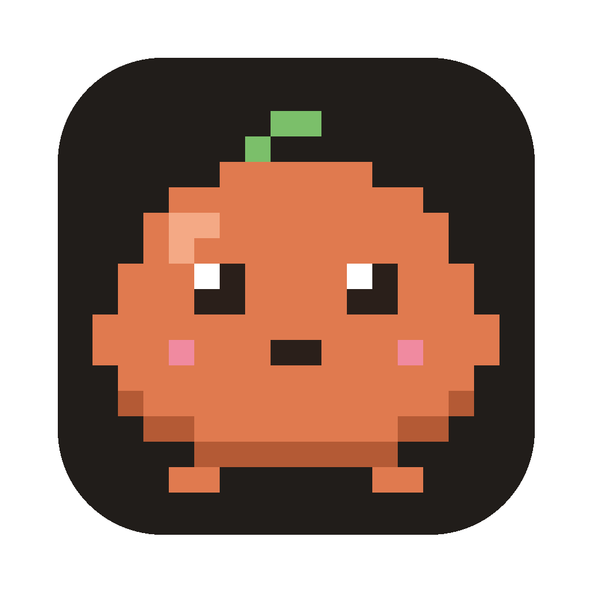

<div align="center">



# Claude Hub

**Use the Claude Code sessions running in tmux on your server from a Mac app — over Tailscale.**

English · [简体中文](README.zh-CN.md)

</div>

- **Sessions**: every tmux session running `claude`, with live status (working / waiting for you / idle). "New chat" opens a new tmux session.
- **Terminal**: full xterm.js terminal attached to the session; Shift+Enter for newlines.
- **Images**: drag in, ⌘V a screenshot, or 📎 — the file is uploaded to the server and pasted into Claude as `[Image #N]`.
- **Notifications** when Claude finishes or needs your confirmation.
- **Optional Claude Code hooks** for exact status (thinking / running a tool / waiting for permission / error) and each conversation's context usage.
- **Usage**: today's Claude Code tokens on the server (input / output / cache) by model and project, plus the last 7 days. Token counts only, no cost estimate.
- **iPhone**: open the same page in Safari and *Add to Home Screen* — bottom tab bar, a session drawer, a key bar (Esc / Tab / arrows / Ctrl-C / Enter) and a text box that suits the phone keyboard. Recommended with HTTPS via `tailscale serve` (stays inside your tailnet).
- **Texas Hold'em** against four bots while you wait, and a **pixel pet** that grows while Claude works (finished tasks earn chips).

All traffic leaves from the server; the Mac only renders the UI. The server listens only on its Tailscale IP and localhost, behind a token.

> Community project, not affiliated with Anthropic. The UI is currently Chinese only.

## Install with Claude Code (recommended)

```
/plugin marketplace add simple-YoungBadBoy/claude-hub
/plugin install hub-for-claude-code@hub-for-claude-code
```

Then, in Claude Code **on the server**: *"install Claude Hub on this server"*, and **on the Mac**: *"install the Claude Hub Mac app"*. The skill checks prerequisites, installs, verifies, and gives you the URL and token.

## Manual install

**Server** (Linux + systemd; needs tmux, Claude Code, Tailscale, Go ≥ 1.22, Node ≥ 18):

```bash
git clone https://github.com/simple-YoungBadBoy/claude-hub ~/claude-hub
~/claude-hub/deploy/install.sh        # builds and starts the systemd --user service on :7788
cat ~/claude-hub/data/token           # you enter this once in the app
```

**Mac**: download `Claude-Hub-macos.zip` from [Releases](https://github.com/simple-YoungBadBoy/claude-hub/releases/latest), move the app to Applications, then run `xattr -dr com.apple.quarantine "/Applications/Claude Hub.app"` (the build is unsigned). Enter `http://<server>:7788` and the token.

A browser works too: open `http://<server>:7788`. If you run Clash or another system proxy, add `100.64.0.0/10,*.ts.net` to its bypass list (the app doesn't need this).

**Update**: `git -C ~/claude-hub pull && ~/claude-hub/deploy/install.sh`, then ⌘R in the app. The app itself only needs reinstalling when a release says so.

## How it works

```
Claude Hub.app (Tauri) ── 127.0.0.1:17788 ─┐
                                           └─ Tailscale ──> claude-hub (Go, :7788) ── tmux ── claude
```

- `server/` — Go: tmux control, pty ↔ websocket, uploads, poker engine, pet.
- `web/` — React + xterm.js UI, embedded into the server binary.
- `mac/` — Tauri shell: settings, local forwarder (bypasses system proxies), native notifications.
- `plugin/` — the Claude Code plugin / skill.

## Development

This project is maintained with Claude Code; the workflow (review → implement → `scripts/check.sh` → live test → push) is in [CLAUDE.md](CLAUDE.md), decisions in [docs/requests.md](docs/requests.md). Enable the pre-push gate once per clone: `git config core.hooksPath .githooks`.

## License

MIT
